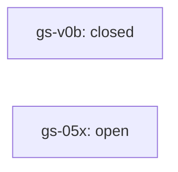

# AutoQA roadmap

This is one skill within G-Skills. Its work does not define the whole collection. State is generated from the shared native graph using the `skill:autoqa` label.

[Quarter plan and preview gates](../../plans/2026-10-14-quarter.md). This skill does not need every optional feature finished before a supported, evidence-backed preview.

## Task graph

| Task | State | Priority | Owner role | Target | Blocking prerequisites |
|---|---|---:|---|---|---|
| `gs-v0b` Adapt AutoQA into witnessed journey verification | closed | 1 | quality-maintainer | 2026-11-05 | — |
| `gs-05x` Qualify AutoQA on real project journeys | open | 2 | quality-maintainer | 2026-11-12 | — |

## Acceptance and evidence

### gs-v0b — Adapt AutoQA into witnessed journey verification

User-selected adaptation of Parcha AutoQA into an independent G-Skills workflow, with explicit journey completion, source/runtime provenance, offline evidence validation, bounded repair and native installation.

**Acceptance:** Implemented skill with attributed upstream review; passing meaningful ledger regressions, independent task evals, extracted-package check, current source published and installed on the requested host; remaining real-project qualification reported separately.

**Receipt:** Published source 66bc2653e1e8de2ea7a200b7eb273973afe9e38f; 54 helper and 90 shared tests passed; blind comparison17/17 each; immutable archive checked and installed for Codex/Claude; native Codex discovery enabled with no loading errors. See docs/skills/autoqa/QUALIFICATION.md. Real-project trials remain gs-05x.

### gs-05x — Qualify AutoQA on real project journeys

Measure the installed workflow on authorized application work after the synthetic and packet-based qualification. Preserve source/runtime identity, actual browser or API traces, defects found and missed, and effort.

**Acceptance:** Two real project runs include a complete user journey, a failure or interruption path, actual evidence and cleanup; report false positives, coverage gaps and limits without claiming a measured improvement multiplier.

Read the owning skill and current task before acting. Source tests, a running process, client integration and sustained real-world evidence are separate gates. Do not close the programme merely because the source exists.
