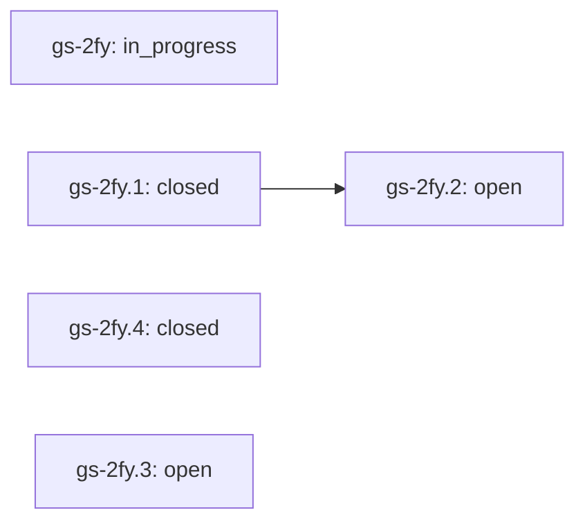

# Codex Clanker Cranker roadmap

This is one skill within G-Skills. Its work does not define the whole collection. State is generated from the shared native graph using the `skill:reset-boost` label.

[Quarter plan and preview gates](../../plans/2026-10-14-quarter.md). This skill does not need every optional feature finished before a supported, evidence-backed preview.

## Task graph

| Task | State | Priority | Owner role | Target | Blocking prerequisites |
|---|---|---:|---|---|---|
| `gs-2fy` Reset Boost: one lever to turn a coding-agent fleet up for a usage reset and back down | in_progress | 1 | reset-boost-maintainer | 2027-01-14 | — |
| `gs-2fy.1` Port the boost lifecycle, engine and dashboard as a generic public skill | closed | 1 | port-agent | 2026-10-21 | — |
| `gs-2fy.2` Qualify on another person's estate before marking ready | open | 1 | field-verification-agent | 2026-11-28 | `gs-2fy.1` |
| `gs-2fy.4` Port the session-first control panel, credit guard and operator-ui kit | closed | 1 | port-agent | 2026-10-21 | — |
| `gs-2fy.3` Evidence-based adapters for desktop apps, Windows terminals and other harnesses | open | 2 | adapter-research-agent | 2027-01-07 | — |

## Acceptance and evidence

### gs-2fy — Reset Boost: one lever to turn a coding-agent fleet up for a usage reset and back down

Public, generic version of a working private tool. Before a provider usage reset, turn every coding-agent account up (stronger model, more reasoning, fast mode or a named preset); once the reset lands, turn back down manually (done) or automatically from usage data. One lever with readback across launch configs and live Herdr/tmux/NTM sessions on several machines, plus an HTML dashboard that shows sessions that did not follow. The user decides when to boost; the agent proposes the command and runs it on instruction.

**Acceptance:** A person other than the author installs the skill folder, configures their own hosts and usage source, boosts and turns down a multi-account estate through a real reset, and the dashboard plus readback match what their sessions actually ran. Source tests do not close this epic.

### gs-2fy.1 — Port the boost lifecycle, engine and dashboard as a generic public skill

Port boost/done/watch/status/dashboard, audit/set/presets, Codex/NTM transforms, live picker switching with footer readback, the SSH and Windows workers, the launch guard and the watch installer. Remove every private estate value; config defaults to this machine only; CAAM layouts are an optional adapter; state and dashboard default to the private state directory.

**Acceptance:** Provider-free tests pass on Python 3.10 (TOML tests skipped) and 3.11+; the cold exported-folder check drives boost, failed-usage hold, reset auto-down, cooling, idle, dashboard and event log; collection validation passes; the privacy review finds no estate identifiers.

**Receipt:** Source accepted on branch skill/reset-boost: 40 provider-free tests pass on Python 3.14 and 3.10 (8 TOML tests skipped on 3.10); tools/validate.py --skill reset-boost passes on both, including the cold exported-folder lifecycle (boost, failed-usage hold, reset auto-down, cooling, idle, dashboard, event log); collection structure validation passes; privacy grep of the diff finds no estate identifiers. A read-only local audit ran on the author's machine (not recorded). Hosted CI on the PR is the release gate; qualification on another estate is gs-2fy.2.

### gs-2fy.2 — Qualify on another person's estate before marking ready

Run audit, a dry-run boost, a real boost and done on a second person's machines (at least one Linux tmux host, one Herdr host and one SSH remote) with their own usage source, and compare the dashboard with what each live session's footer shows. Record unsupported layouts as regressions or documented limits.

**Acceptance:** Recorded receipt of one real reset window on a non-author estate: hosts, session counts at target, held reasons, auto-down trigger, and any mismatch turned into a test. Only then propose status ready.

### gs-2fy.4 — Port the session-first control panel, credit guard and operator-ui kit

Port the private tool's current control panel into the public skill. Engine: Codex status-line telemetry (model, effort, fast mode, run state, 5h/weekly quota left, credits, folder), fast mode as service tier priority toggled live with /fast, the current empty-prompt placeholder, truncated effort, a credit guard that never turns up a session on credits or out of quota, per-session settings (session), read-only observe, posix_spawn for every subprocess. Panel: boost_server.py (stdlib HTTP + SSE, 0600 token, local Host check, one job at a time, background session reads that yield to clicks, /operator-ui.css), boost_agent.py (signals, autopilot, briefs, agent.steps none by default), the session-first assets/console.html, install-watch.sh --serve with ProcessType Standard. Add the collection operator-ui design kit (docs/design) with a validate check that skill copies match and kit pages add no raw colours. Keep every safety property.

**Acceptance:** Provider-free tests (telemetry parsing, credit guard, session overrides, observe, server security, API boost and turn-down, SSE, channels, pane merge, signals, fake agent, style tokens) pass; the cold exported-folder check starts the panel on a free port and fetches /, /operator-ui.css and /api/state with its token; validate --skill reset-boost and --structure-only pass; screenshots at 1440 and 390 px show no sideways scroll; the privacy review finds no estate identifiers.

**Receipt:** Source on main: 64 provider-free reset-boost tests pass on Python 3.14 and 3.12; tools/validate.py --skill reset-boost and --structure-only pass, including the cold exported-folder lifecycle, observe, and a panel start on a free port (401 without token, 403 for a non-local Host, page, stylesheet and /api/state with token). Headless Chromium screenshots of the console against a synthetic estate (idle and boosted, light and dark) at 1440 and 390 px showed no script errors and no page-level sideways scroll. Privacy grep of the diff found no estate identifiers. Python 3.10 was not rerun for this port. Not run against a real estate; qualification stays gs-2fy.2.

### gs-2fy.3 — Evidence-based adapters for desktop apps, Windows terminals and other harnesses

Desktop-app tasks, Windows terminals and harnesses without a readable footer are reported unverified today. Investigate whether each exposes a supported way to enumerate sessions, read the current model without the conversation, and change it without submitting work.

**Acceptance:** For each surface: a documented supported API with a provider-free test and readback, or an explicit unsupported note. No prompt injection, transcript reads or restarts.

Read the owning skill and current task before acting. Source tests, a running process, client integration and sustained real-world evidence are separate gates. Do not close the programme merely because the source exists.
