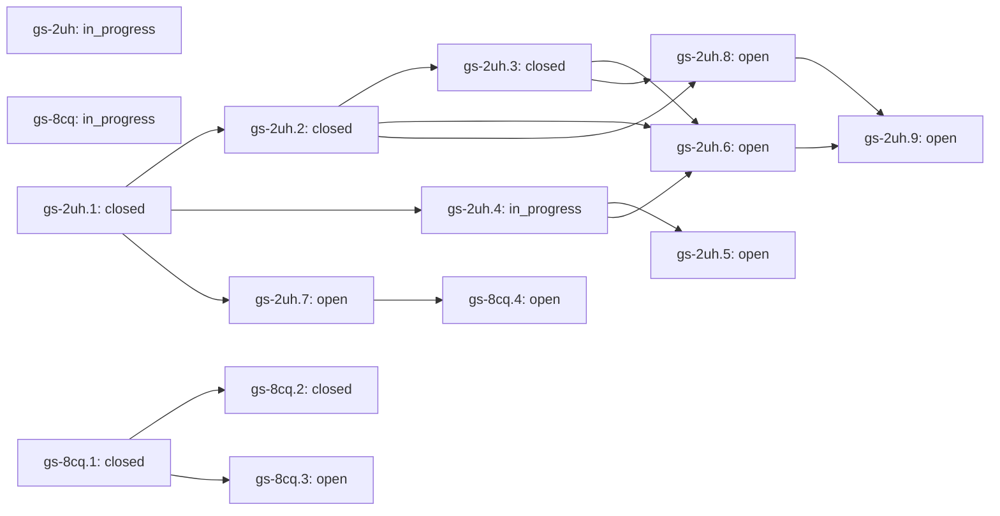

# VPS Health roadmap

This is one skill within G-Skills. Its work does not define the whole collection. State is generated from the shared native graph using the `skill:vps-health` label.

## Task graph

| Task | State | Priority | Blocking prerequisites |
|---|---|---:|---|
| `gs-2uh` Agent-owned VPS investigation with minimal human work | in_progress | 1 | — |
| `gs-8cq` Integrate reviewed Gemini guest-context proposals | in_progress | 1 | — |
| `gs-2uh.1` Discover explicit scope and produce an idempotent executable plan | closed | 1 | — |
| `gs-2uh.2` Manage collector and viewer beyond a terminal-agent session | closed | 1 | `gs-2uh.1` |
| `gs-2uh.3` Expose agent progress and recovery in the dashboard | closed | 1 | `gs-2uh.2` |
| `gs-2uh.4` Discover host-native connector capabilities only when needed | in_progress | 1 | `gs-2uh.1` |
| `gs-2uh.5` Bind external actions to reviewed content and verified results | open | 1 | `gs-2uh.4` |
| `gs-2uh.6` Qualify cold Codex and Claude Code user journeys | open | 1 | `gs-2uh.2`, `gs-2uh.3`, `gs-2uh.4` |
| `gs-2uh.8` Validate multi-day operation and measurement usefulness | open | 1 | `gs-2uh.2`, `gs-2uh.3` |
| `gs-8cq.1` Retain aligned passive storage, memory and network context | closed | 1 | — |
| `gs-8cq.2` Compare guest traits without false physical-migration proof | closed | 1 | `gs-8cq.1` |
| `gs-2uh.7` Cover heterogeneous estates and non-Linux agent hosts | open | 2 | `gs-2uh.1` |
| `gs-2uh.9` Make self-improvement a reviewed evidence-to-regression loop | open | 2 | `gs-2uh.6`, `gs-2uh.8` |
| `gs-8cq.3` Design approved active CPU, memory and storage experiments | open | 2 | `gs-8cq.1` |
| `gs-8cq.4` Qualify authorized SSH fleet and bounded path diagnostics | open | 2 | `gs-2uh.7` |

## Acceptance and evidence

### gs-2uh — Agent-owned VPS investigation with minimal human work

The human supplies goals, authorized targets and approvals; their terminal coding agent scaffolds, verifies, runs, resumes and reports. Local scripts own deterministic state, not model reasoning or external OAuth. Keep one measurement authority, private data boundaries and scoped external actions. Source implementation and real client/connector/field qualification are separate gates.

**Acceptance:** A fresh user can hand this skill to a supported terminal agent, approve a bounded plan once, obtain a functioning dashboard and retained evidence, resume after session loss, and handle a connector need without copying secrets or executing setup by hand. Actual client/OAuth and multi-day outcomes are separately qualified; unit tests do not close the epic.

### gs-8cq — Integrate reviewed Gemini guest-context proposals

Read both supplied Gemini documents in full. Preserve useful observations while validating semantics and rejecting unsupported physical-host proofs. Do not copy active probes into the default passive flow.

**Acceptance:** Trace each source group to adopted/modified/deferred/rejected disposition; passive retained context and safe comparisons pass source and runtime checks; active experiment/SSH acceptance stays separately open.

### gs-2uh.1 — Discover explicit scope and produce an idempotent executable plan

Agent determines the authorized target/environment first, reuses a matching workspace and emits one bounded plan. No broad credential or network discovery. Plan hash binds source, target, settings and duration, not a claim of consent.

**Acceptance:** Read-only plan; one approval applies to the reviewed bounded operations; wrong hash, changed target/config/source or mismatched existing workspace refused. Existing identical runtime returns its identity without duplication.

**Receipt:** Source contract delivered in v0.6: 35 agent runtime tests include actual detached CLI/HTTP, simultaneous start, bounded completion, abrupt owned-child exit/recovery, safe stop and private handoff; browser source verifies the Agent view and capability distinction. The old approval cannot renew a completed run. See docs/verification-v0.6.0.md. This is Linux source/runtime qualification, not real Codex/Claude/OAuth or multi-day field acceptance.

### gs-2uh.2 — Manage collector and viewer beyond a terminal-agent session

One owned Linux worker launches detached with bounded lifetime, loopback dashboard, private progress and cooperative stop. Never kill arbitrary/reused PIDs or compete with manual collection. No root/system service, silent restart or reboot-survival claim.

**Acceptance:** Test actual cold CLI start, exact URL/port, idempotent concurrent start, source/config change, direct process identity, natural budget completion, stop, crash/stale record and preserved history. End tests with no workers left.

**Receipt:** Source contract delivered in v0.6: 35 agent runtime tests include actual detached CLI/HTTP, simultaneous start, bounded completion, abrupt owned-child exit/recovery, safe stop and private handoff; browser source verifies the Agent view and capability distinction. The old approval cannot renew a completed run. See docs/verification-v0.6.0.md. This is Linux source/runtime qualification, not real Codex/Claude/OAuth or multi-day field acceptance.

### gs-2uh.3 — Expose agent progress and recovery in the dashboard

Human sees actual managed state and blocking questions in the existing viewer; a new agent reads private HANDOFF.md plus machine status and continues instead of repeating manual instructions. No browser terminal or hidden mutation API.

**Acceptance:** CLI and HTML agree on running/stopped/stale state. Distinguish process liveness, collector evidence and multi-day readiness. Resume preserves old data and surfaces next safe operation.

**Receipt:** Source contract delivered in v0.6: 35 agent runtime tests include actual detached CLI/HTTP, simultaneous start, bounded completion, abrupt owned-child exit/recovery, safe stop and private handoff; browser source verifies the Agent view and capability distinction. The old approval cannot renew a completed run. See docs/verification-v0.6.0.md. This is Linux source/runtime qualification, not real Codex/Claude/OAuth or multi-day field acceptance.

### gs-2uh.4 — Discover host-native connector capabilities only when needed

Skill instructs Codex/Claude/other agents to use live tool registry and approved connector discovery. Local capability requests declare intent/data/minimum scopes; they cannot create OAuth access or pretend a connection exists.

**Acceptance:** Explicit request has stable schema, minimal scope, purpose and expected result. Missing capability asks the user for the native OAuth/approval step once, not manual token copying. Read, draft and send are distinct permissions. No installed connector implies send authority.

### gs-2uh.5 — Bind external actions to reviewed content and verified results

For requested mail/calendar/provider actions, use host-native tools, verified recipient/thread, current reviewed payload and returned receipt. Handle unknown outcomes without blind retries. Existing support-contact prohibition remains until a fresh explicit request.

**Acceptance:** End-to-end tests with actual authorized connector route or controlled sandbox show read/draft/send distinctions, stale approval rejection, recipient/content binding and uncertain-outcome recovery. No raw customer data becomes public.

### gs-2uh.6 — Qualify cold Codex and Claude Code user journeys

Tests of Python/HTML do not prove a real terminal coding agent activates the skill and scaffolds correctly. Define minimal prompts and count manual interventions; use actual approved client accounts only.

**Acceptance:** Fresh-install and resume sessions on at least Codex and Claude Code produce an audited task trace. Target selection, connector gaps and handoff work without fabricated tool names or unapproved hooks. Failures become synthetic regressions.

### gs-2uh.8 — Validate multi-day operation and measurement usefulness

Runtime existence is not continuous evidence. Exercise retention, gaps, pressure, service impact, stopped processes, restart and source epochs over real durations using synthetic faults and authorized passive hosts.

**Acceptance:** Multi-day evidence and repeatable decision checks on representative setups, bounded storage and meaningful unknowns. CPU accounting never claims complete disk/network/application diagnosis. Reboot durability explicitly handled or excluded.

### gs-8cq.1 — Retain aligned passive storage, memory and network context

Add bounded proc/sys reads, correct hex softnet parsing, per-device request means, PSI total deltas and guest memory activity to the existing local capture history.

**Acceptance:** Unknown idle latency, reset counters, NVMe/mapper/overlay identity, independent acquisition brackets and layered-device non-aggregation are tested; raw sources and dashboard context are retained without changing CPU verdicts.

**Receipt:** Source accepted: collection/selected-skill validation passes 255 Python tests, 12 chart contracts and 29 real-loopback browser groups. Two unrelated temporary skills prove independent version/check/package ownership, including a failing-before large-unrelated-skill budget regression. Actual selected VPS ZIP extracted and exercised; passive Linux context/retention/compare smoke completed without active tests. See docs/collection-design.md and docs/skills/vps-health/verification-v0.7.0.md. Hosted exact-source CI remains the release gate.

### gs-8cq.2 — Compare guest traits without false physical-migration proof

Add private snapshot/observe/compare routes using guest-visible CPU, clock and DMI traits. Equal traits do not prove same physical host; changed traits cannot attest a move.

**Acceptance:** Replays preserve source/time/boot boundaries and explicitly refuse physical-host verification. Same/mixed subject, changed/identical/missing traits and private output boundaries have regressions.

**Receipt:** Source accepted: collection/selected-skill validation passes 255 Python tests, 12 chart contracts and 29 real-loopback browser groups. Two unrelated temporary skills prove independent version/check/package ownership, including a failing-before large-unrelated-skill budget regression. Actual selected VPS ZIP extracted and exercised; passive Linux context/retention/compare smoke completed without active tests. See docs/collection-design.md and docs/skills/vps-health/verification-v0.7.0.md. Hosted exact-source CI remains the release gate.

### gs-2uh.7 — Cover heterogeneous estates and non-Linux agent hosts

One VPS, existing metrics fleet and remote authorized Linux host are distinct routes. Inventory remains declared vs discovered; Windows/macOS lifecycle/system scheduler support needs its own tests.

**Acceptance:** Every expected asset retains measured, unresolved, excluded or inaccessible state. No silent full-account claim. Platform-specific persistence/remote access and reconnect behavior verified before offered as automatic.

### gs-2uh.9 — Make self-improvement a reviewed evidence-to-regression loop

Learn from agent friction and monitoring failures without importing hostile logs as instructions. Preserve sanitized proposals and tests; never rewrite thresholds, install connectors or grant actions autonomously.

**Acceptance:** New failures map to smallest owning regression. Exported skill/release integrity, privacy and actual-runtime tests gate updates; no paid skill bodies or private captures in repository.

### gs-8cq.3 — Design approved active CPU, memory and storage experiments

Gemini proposes hashing, page-touch and fsync distributions. They impose workload and have many confounds; do not run them automatically or invent universal baselines.

**Acceptance:** Define explicit workload, target mount, byte/op/time budgets, versioned baseline, stop conditions, quantile uncertainty and user approval; demonstrate measurements distinguish their own interference and never manufacture provider guilt.

### gs-8cq.4 — Qualify authorized SSH fleet and bounded path diagnostics

Treat SSH inventory expansion and network probes as approved targets/traffic, not scan-all-config or implicit third-party lookup. Keep unmeasured and excluded assets visible.

**Acceptance:** Controlled concurrency, timeouts, missing dependencies, exact authorized host/destination inventory, remote artifacts and client/tunnel limitations verified. Loss/time_squeeze never alone prove host-vswitch fault.

Read the owning skill and current task before acting. Source tests, a running process, client integration and sustained real-world evidence are separate gates. Do not close the programme merely because the source exists.
