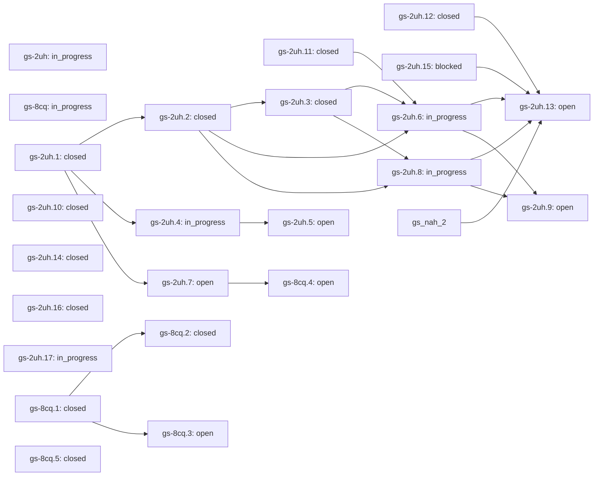

# VPS Health roadmap

This is one skill within G-Skills. Its work does not define the whole collection. State is generated from the shared native graph using the `skill:vps-health` label.

[Quarter plan and preview gates](../../plans/2026-10-14-quarter.md). This skill does not need every optional feature finished before a supported, evidence-backed preview.

## Task graph

| Task | State | Priority | Owner role | Target | Blocking prerequisites |
|---|---|---:|---|---|---|
| `gs-2uh` Agent-owned VPS investigation with minimal human work | in_progress | 1 | vps-programme-maintainer | 2027-01-14 | — |
| `gs-8cq` Integrate reviewed Gemini guest-context proposals | in_progress | 1 | diagnostics-maintainer | 2027-01-14 | — |
| `gs-2uh.1` Discover explicit scope and produce an idempotent executable plan | closed | 1 | Unassigned | — | — |
| `gs-2uh.10` Fix same-route Prometheus setup retries without scope drift | closed | 1 | runtime-agent | 2026-10-21 | — |
| `gs-2uh.11` Verify cold and resumed client journeys from actual artifacts | closed | 1 | verification-agent | 2026-10-28 | — |
| `gs-2uh.12` Audit private-state boundaries and release failure recovery | closed | 1 | safety-review-agent | 2026-11-07 | — |
| `gs-2uh.13` Qualify the narrow passive preview before broader promotion | open | 1 | Gurpreet-and-quality-maintainer | 2026-11-14 | `gs-2uh.12`, `gs-2uh.15`, `gs-2uh.6`, `gs-2uh.8`, `gs-nah.2` |
| `gs-2uh.14` Deliver the evidence-first workbench from the design sprint | closed | 1 | design-implementation-agent | 2026-11-07 | — |
| `gs-2uh.15` Qualify workload context by time and expose repeated shortfall evidence | blocked | 1 | evidence-implementation-agent | 2026-11-07 | — |
| `gs-2uh.16` Ship realistic agent eval contracts and an actionable UI CLI support map | closed | 1 | skill-quality-agent | 2026-11-07 | — |
| `gs-2uh.17` Make the public entry explicit and bundle its release support boundary | in_progress | 1 | publication-verification-agent | 2026-11-07 | — |
| `gs-2uh.2` Manage collector and viewer beyond a terminal-agent session | closed | 1 | Unassigned | — | `gs-2uh.1` |
| `gs-2uh.3` Expose agent progress and recovery in the dashboard | closed | 1 | Unassigned | — | `gs-2uh.2` |
| `gs-2uh.4` Discover host-native connector capabilities only when needed | in_progress | 1 | connector-agent | 2026-11-28 | `gs-2uh.1` |
| `gs-2uh.5` Bind external actions to reviewed content and verified results | open | 1 | connector-verification-agent | 2026-12-07 | `gs-2uh.4` |
| `gs-2uh.6` Qualify cold Codex and Claude Code user journeys | in_progress | 1 | client-verification-agent | 2026-11-07 | `gs-2uh.11`, `gs-2uh.2`, `gs-2uh.3` |
| `gs-2uh.8` Validate multi-day operation and measurement usefulness | in_progress | 1 | field-verification-agent | 2026-11-14 | `gs-2uh.2`, `gs-2uh.3` |
| `gs-8cq.1` Retain aligned passive storage, memory and network context | closed | 1 | Unassigned | — | — |
| `gs-8cq.2` Compare guest traits without false physical-migration proof | closed | 1 | Unassigned | — | `gs-8cq.1` |
| `gs-2uh.7` Cover heterogeneous estates and non-Linux agent hosts | open | 2 | runtime-and-estate-agent | 2026-12-07 | `gs-2uh.1` |
| `gs-2uh.9` Make self-improvement a reviewed evidence-to-regression loop | open | 2 | quality-maintainer | 2027-01-07 | `gs-2uh.6`, `gs-2uh.8` |
| `gs-8cq.3` Design approved active CPU, memory and storage experiments | open | 2 | experiment-method-agent | 2026-12-07 | `gs-8cq.1` |
| `gs-8cq.4` Qualify authorized SSH fleet and bounded path diagnostics | open | 2 | fleet-verification-agent | 2027-01-07 | `gs-2uh.7` |
| `gs-8cq.5` Extend provider playbooks from the supplied proposals with dated primary evidence | closed | 2 | provider-research-agent | 2026-11-28 | — |

## Acceptance and evidence

### gs-2uh — Agent-owned VPS investigation with minimal human work

The human supplies goals, authorized targets and approvals; their terminal coding agent scaffolds, verifies, runs, resumes and reports. Local scripts own deterministic state, not model reasoning or external OAuth. Keep one measurement authority, private data boundaries and scoped external actions. Source implementation and real client/connector/field qualification are separate gates.

**Acceptance:** A fresh user can hand this skill to a supported terminal agent, approve a bounded plan once, obtain a functioning dashboard and retained evidence, resume after session loss, and handle a connector need without copying secrets or executing setup by hand. Actual client/OAuth and multi-day outcomes are separately qualified; unit tests do not close the epic.

### gs-8cq — Integrate reviewed Gemini guest-context proposals

Read both supplied Gemini documents in full. Preserve useful observations while validating semantics and rejecting unsupported physical-host proofs. Do not copy active probes into the default passive flow.

**Acceptance:** Trace each source group to adopted/modified/deferred/rejected disposition; passive retained context and safe comparisons pass source and runtime checks; active experiment/SSH acceptance stays separately open.

### gs-2uh.1 — Discover explicit scope and produce an idempotent executable plan

Agent determines the authorized target/environment first, reuses a matching workspace and emits one bounded plan. No broad credential or network discovery. Plan hash binds source, target, settings and duration, not a claim of consent.

**Acceptance:** Read-only plan; one approval applies to the reviewed bounded operations; wrong hash, changed target/config/source or mismatched existing workspace refused. Existing identical runtime returns its identity without duplication.

**Receipt:** Source contract delivered in v0.6: 35 agent runtime tests include actual detached CLI/HTTP, simultaneous start, bounded completion, abrupt owned-child exit/recovery, safe stop and private handoff; browser source verifies the Agent view and capability distinction. The old approval cannot renew a completed run. See docs/verification-v0.6.0.md. This is Linux source/runtime qualification, not real Codex/Claude/OAuth or multi-day field acceptance.

### gs-2uh.10 — Fix same-route Prometheus setup retries without scope drift

A repeated identical existing-monitoring setup was rejected merely because profile/endpoints were supplied again. Reproduce it and allow only semantically matching saved routes. Changed sources or credential variable names remain refused.

**Acceptance:** Failing-before matching-route and auto-resume cases pass; changed endpoint/inventory/credential variable and missing original profile cases retain no-mutation guarantees. Existing runtime and extracted artifact checks pass.

**Receipt:** Two matching-route regressions failed before the fix. All six focused cases pass, and an actual loopback metrics worker reuses its identity/deadline on repeated identical setup while empty data stays HOLD. Existing source suite passed 281 tests plus this new live fixture. Final exact-head CI is the release gate; measurements and action permissions unchanged.

### gs-2uh.11 — Verify cold and resumed client journeys from actual artifacts

Provide private trial preparation and an artifact evaluator for future real-client runs. Check installed release bytes, actual process/HTTP, same-run continuation, retained observations and stop. A model success message or selected client name is not proof of execution.

**Acceptance:** Preparation runs no client or monitoring. Positive actual-worker fixtures and negative claimed-success, modified-source, changed-run and missing-stop cases prove the evaluator. Real Codex/Claude traces and semantic review remain required under gs-2uh.6; fixture tests cannot close that gate.

**Receipt:** Private artifact evaluator and thirteen tests delivered: prepared source hashes, actual worker/HTTP, same-run stop and retained observations, plus false-success and malformed boundary cases. The evaluator explicitly cannot certify native Codex/Claude execution; actual traces and semantic review remain open in gs-2uh.6.

### gs-2uh.12 — Audit private-state boundaries and release failure recovery

Before wider VPS preview, review installation/runtime state, source updates, relative paths, malformed input, partial bootstrap, private file handling and failed/uncertain requests using existing ownership code rather than a second framework.

**Acceptance:** A recorded threat-model pass and regressions cover high-risk read/write/launch boundaries, interrupted setup and upgrade recovery. No permission bypass, automatic provider contact or customer-data upload is introduced. Unresolved high-severity findings block the preview.

**Receipt:** Implemented and verified private-workspace recovery: 28 new real file/process/SQLite regressions, 353 complete Python tests, 12 chart contracts and 29 real-browser groups pass. Actual v0.7.2 -> candidate v0.7.3 install/start/verify/stop/restore/removal preserved all 3 synthetic subjects and 2,288 points. Failed initializations remain private and retryable; linked/nonregular/exposed state refuses; SQLite owns rollback; broken config cannot prevent an owned stop; source replacement stops the worker for review. Threat boundary and residual limits recorded in docs/skills/vps-health/verification-v0.7.3.md. Exact-source hosted CI remains the release gate. No production, provider or native-client claim.

### gs-2uh.13 — Qualify the narrow passive preview before broader promotion

A supported passive-preview decision is narrower than the full VPS programme. It requires real basic-client, private-state and sustained-observation evidence, while optional mail sending, every provider, active benchmarks and wider platforms stay excluded unless separately qualified. Do not hold all unrelated G-Skills entries behind this VPS-specific decision.

**Acceptance:** Recorded owner review references actual client and 72-hour pilot receipts, safe install/update evidence and resolved high-severity safety findings. Supported and unsupported claims are explicit. Reaching this task never automatically posts an announcement, sends an invitation or contacts a provider.

### gs-2uh.14 — Deliver the evidence-first workbench from the design sprint

Replace concept-board decoration and the overloaded overview with a coherent implemented investigation interface. One existing evidence authority; clear scope and next action; preserve uncertainty, currentness and no provider/contact permission. Improve desktop/mobile navigation, chart investigation, review pause and agent handoff. Do not touch the running private pilot or Reset Boost.

**Acceptance:** Actual desktop/mobile/offline/live viewer flows pass; main/inbox actions agree; history and gaps remain unchanged; paused review is distinct from stopped collection; disclosures survive refresh; keyboard navigation and private exports work. Inspect real rendered screenshots, update the installed skill walkthrough and ship a scoped release with synthetic proof, not an image-only mockup.

**Receipt:** Implemented the actual evidence workbench with one canonical next action, linked observations, pinned private review and handoff, local search, view-only pause and agent-owned setup. 454 Python tests, 27 JavaScript contracts and 39 actual-loopback browser groups pass; real desktop/mobile screenshots inspected. Private atomic-read failure reproduced and fixed without weakening privacy. Exact-head CI and extracted-package acceptance remain release gates. Technical preview only; running field pilot and other skills are not changed. See design-workbench.md and workbench-verification-v0.9.0.json under docs/skills/vps-health.

### gs-2uh.15 — Qualify workload context by time and expose repeated shortfall evidence

A real source regression allows one quiet CFS/pressure sample to describe three days as no high recorded pressure. Fix per-channel coverage and currentness; retain canonical CPU policy and expose interval-duration bands, gaps, shortfall runs and recorded-execution context. Add agent-owned private bounded time-range reports and useful workbench evidence, using the normalized observations rather than decimated chart pixels. Leave draft PR22 and the running passive pilot unchanged.

**Acceptance:** Failure-first sparse/stale-context cases pass; no missing-as-zero, duplicate-time inflation, gap stitching or provider guilt. Means agree with the existing union-weighted source. Actual legacy workspace report is read-only; standalone export and browser coverage/timeline cases pass. Native Beads closure is source acceptance, not completion of the 72-hour field pilot.

### gs-2uh.16 — Ship realistic agent eval contracts and an actionable UI CLI support map

Apply Anthropic skill-creator task/grading conventions and outcome-based eval guidance to VPS Health. Include concrete synthetic artifact tasks, balanced trigger/nontrigger queries, actual old/new native attempts and a grader that separates no-inference failures from incomplete execution and real outcomes. Teach the existing UI/CLI/host workflow and local software support without unnecessary OAuth.

**Acceptance:** Bundled three-case artifact schema, 20 balanced trigger queries, tested grader, upstream validator/reviewer integration and precise source/output evidence. Real native failures stay ungraded; no model uplift or trigger score is fabricated. Runtime/connector and blocked frontend work remain separate gates.

**Receipt:** Three source-backed artifact cases, twenty balanced trigger queries, fifteen grader tests and an actionable UI/CLI/support map delivered. Official static reviewer renders sanitized blocked-attempt cards. Six native old/new sessions were attempted but existing OAuth expired before inference, so no behavior score/uplift is claimed. Native-client gate gs-2uh.6, inline UI gs-2uh.15 and actual mail integrations remain open. Receipt agent-eval-proof-v0.9.4.json.

### gs-2uh.17 — Make the public entry explicit and bundle its release support boundary

Publication audit of the actual v0.9.4 archive found its 39 authored local links valid, but SKILL.md never identified the CLI executable. Make that first invocation explicit and ship the support matrix inside the independently installed skill. Add actual archive reference checks, not an unsupported claim of universal usability.

**Acceptance:** Official metadata validation and extracted archive checks pass; first capabilities/help work via a spaced absolute install path from an unrelated directory without site-packages or creating a workspace. Missing/unshipped reference fixtures fail. Existing runtime/UI behavior and all unresolved native-client/field/connector gates remain unchanged.

### gs-2uh.2 — Manage collector and viewer beyond a terminal-agent session

One owned Linux worker launches detached with bounded lifetime, loopback dashboard, private progress and cooperative stop. Never kill arbitrary/reused PIDs or compete with manual collection. No root/system service, silent restart or reboot-survival claim.

**Acceptance:** Test actual cold CLI start, exact URL/port, idempotent concurrent start, source/config change, direct process identity, natural budget completion, stop, crash/stale record and preserved history. End tests with no workers left.

**Receipt:** Source contract delivered in v0.6: 35 agent runtime tests include actual detached CLI/HTTP, simultaneous start, bounded completion, abrupt owned-child exit/recovery, safe stop and private handoff; browser source verifies the Agent view and capability distinction. The old approval cannot renew a completed run. See docs/verification-v0.6.0.md. This is Linux source/runtime qualification, not real Codex/Claude/OAuth or multi-day field acceptance.

### gs-2uh.3 — Expose agent progress and recovery in the dashboard

Human sees actual managed state and blocking questions in the existing viewer; a new agent reads private HANDOFF.md plus machine status and continues instead of repeating manual instructions. No browser terminal or hidden mutation API.

**Acceptance:** CLI and HTML agree on running/stopped/stale state. Distinguish process liveness, collector evidence and multi-day readiness. Resume preserves old data and surfaces next safe operation.

**Receipt:** Source contract delivered in v0.6: 35 agent runtime tests include actual detached CLI/HTTP, simultaneous start, bounded completion, abrupt owned-child exit/recovery, safe stop and private handoff; browser source verifies the Agent view and capability distinction. The old approval cannot renew a completed run. See docs/verification-v0.6.0.md. This is Linux source/runtime qualification, not real Codex/Claude/OAuth or multi-day field acceptance.

### gs-2uh.4 — Discover host-native connector capabilities only when needed

Skill instructs Codex/Claude/other agents to use live tool registry and approved connector discovery. Local capability requests declare intent/data/minimum scopes; they cannot create OAuth access or pretend a connection exists.

**Acceptance:** Explicit request has stable schema, minimal scope, purpose and expected result. Missing capability asks the user for the native OAuth/approval step once, not manual token copying. Read, draft and send are distinct permissions. No installed connector implies send authority.

### gs-2uh.5 — Bind external actions to reviewed content and verified results

For requested mail/calendar/provider actions, use host-native tools, verified recipient/thread, current reviewed payload and returned receipt. Handle unknown outcomes without blind retries. Existing support-contact prohibition remains until a fresh explicit request.

**Acceptance:** End-to-end tests with actual authorized connector route or controlled sandbox show read/draft/send distinctions, stale approval rejection, recipient/content binding and uncertain-outcome recovery. No raw customer data becomes public.

### gs-2uh.6 — Qualify cold Codex and Claude Code user journeys

Tests of Python/HTML do not prove a real terminal coding agent activates the skill and scaffolds correctly. Define minimal prompts and count manual interventions; use actual approved client accounts only.

**Acceptance:** Fresh-install and resume sessions on at least Codex and Claude Code produce an audited task trace. Target selection, connector gaps and handoff work without fabricated tool names or unapproved hooks. Failures become synthetic regressions.

### gs-2uh.8 — Validate multi-day operation and measurement usefulness

Runtime existence is not continuous evidence. Exercise retention, gaps, pressure, service impact, stopped processes, restart and source epochs over real durations using synthetic faults and authorized passive hosts.

**Acceptance:** Multi-day evidence and repeatable decision checks on representative setups, bounded storage and meaningful unknowns. CPU accounting never claims complete disk/network/application diagnosis. Reboot durability explicitly handled or excluded.

### gs-8cq.1 — Retain aligned passive storage, memory and network context

Add bounded proc/sys reads, correct hex softnet parsing, per-device request means, PSI total deltas and guest memory activity to the existing local capture history.

**Acceptance:** Unknown idle latency, reset counters, NVMe/mapper/overlay identity, independent acquisition brackets and layered-device non-aggregation are tested; raw sources and dashboard context are retained without changing CPU verdicts.

**Receipt:** Source accepted: collection/selected-skill validation passes 255 Python tests, 12 chart contracts and 29 real-loopback browser groups. Two unrelated temporary skills prove independent version/check/package ownership, including a failing-before large-unrelated-skill budget regression. Actual selected VPS ZIP extracted and exercised; passive Linux context/retention/compare smoke completed without active tests. See docs/collection-design.md and docs/skills/vps-health/verification-v0.7.0.md. Hosted exact-source CI remains the release gate.

### gs-8cq.2 — Compare guest traits without false physical-migration proof

Add private snapshot/observe/compare routes using guest-visible CPU, clock and DMI traits. Equal traits do not prove same physical host; changed traits cannot attest a move.

**Acceptance:** Replays preserve source/time/boot boundaries and explicitly refuse physical-host verification. Same/mixed subject, changed/identical/missing traits and private output boundaries have regressions.

**Receipt:** Source accepted: collection/selected-skill validation passes 255 Python tests, 12 chart contracts and 29 real-loopback browser groups. Two unrelated temporary skills prove independent version/check/package ownership, including a failing-before large-unrelated-skill budget regression. Actual selected VPS ZIP extracted and exercised; passive Linux context/retention/compare smoke completed without active tests. See docs/collection-design.md and docs/skills/vps-health/verification-v0.7.0.md. Hosted exact-source CI remains the release gate.

### gs-2uh.7 — Cover heterogeneous estates and non-Linux agent hosts

One VPS, existing metrics fleet and remote authorized Linux host are distinct routes. Inventory remains declared vs discovered; Windows/macOS lifecycle/system scheduler support needs its own tests.

**Acceptance:** Every expected asset retains measured, unresolved, excluded or inaccessible state. No silent full-account claim. Platform-specific persistence/remote access and reconnect behavior verified before offered as automatic.

### gs-2uh.9 — Make self-improvement a reviewed evidence-to-regression loop

Learn from agent friction and monitoring failures without importing hostile logs as instructions. Preserve sanitized proposals and tests; never rewrite thresholds, install connectors or grant actions autonomously.

**Acceptance:** New failures map to smallest owning regression. Exported skill/release integrity, privacy and actual-runtime tests gate updates; no paid skill bodies or private captures in repository.

### gs-8cq.3 — Design approved active CPU, memory and storage experiments

Gemini proposes hashing, page-touch and fsync distributions. They impose workload and have many confounds; do not run them automatically or invent universal baselines.

**Acceptance:** Define explicit workload, target mount, byte/op/time budgets, versioned baseline, stop conditions, quantile uncertainty and user approval; demonstrate measurements distinguish their own interference and never manufacture provider guilt.

### gs-8cq.4 — Qualify authorized SSH fleet and bounded path diagnostics

Treat SSH inventory expansion and network probes as approved targets/traffic, not scan-all-config or implicit third-party lookup. Keep unmeasured and excluded assets visible.

**Acceptance:** Controlled concurrency, timeouts, missing dependencies, exact authorized host/destination inventory, remote artifacts and client/tunnel limitations verified. Loss/time_squeeze never alone prove host-vswitch fault.

### gs-8cq.5 — Extend provider playbooks from the supplied proposals with dated primary evidence

The supplied Gemini proposals mention additional suppliers such as Vultr, OVH and Netcup. Treat these as requested coverage to research, not automatically detected brands or promises inferred from generic VPS terms. Preserve the existing unknown/other route until each exact plan distinction is supported.

**Acceptance:** Add dated primary-source plan/allocation/usage references, clear missing-plan handling and an approved concise support-question route for each added provider. No unverified SLA, universal CPU floor, automatic IP lookup, migration demand or downtime consent is inferred. Tests keep supplier-specific terms separate from the chosen diagnostic thresholds.

**Receipt:** Completed the explicit additional-provider reference acceptance: Vultr, OVHcloud and netcup primary sources checked 2026-10-15; product/allocation/availability distinctions and concise plan-question guidance shipped through CLI, profiles and workbench. Per-fact review dates prevent false freshness and existing Contabo diagnostics now render. 489 Python tests, 27 JS contracts, 43 actual browser scenarios and the actual extracted 50-file archive pass, including all three labelled unmeasured workspaces and offline references. No CPU floor, API discovery, active probe or consent invented. Prior peer-matrix/active-network ideas remain separately scoped to gs-8cq.3/.4. Exact-head CI is the release gate; docs/skills/vps-health/provider-verification-v0.9.2.md records scope and limits.

Read the owning skill and current task before acting. Source tests, a running process, client integration and sustained real-world evidence are separate gates. Do not close the programme merely because the source exists.
